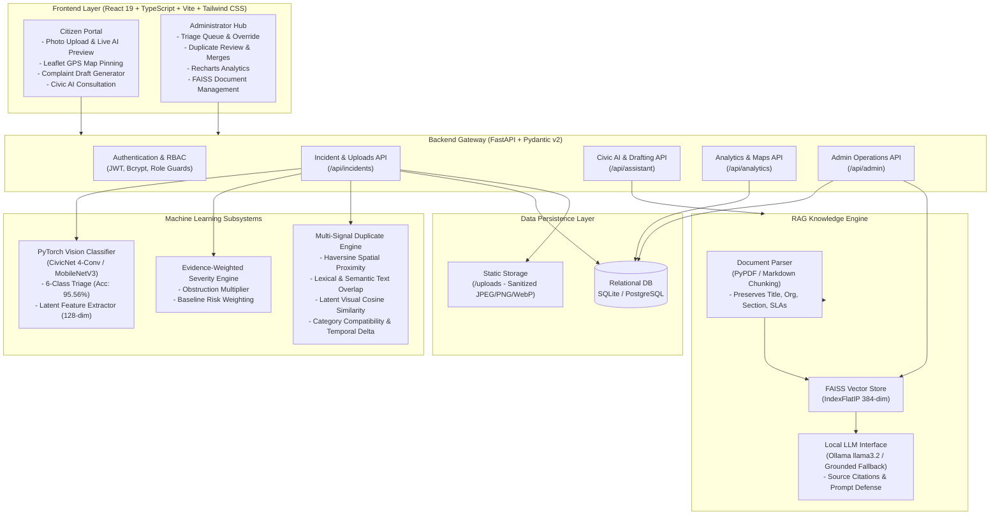
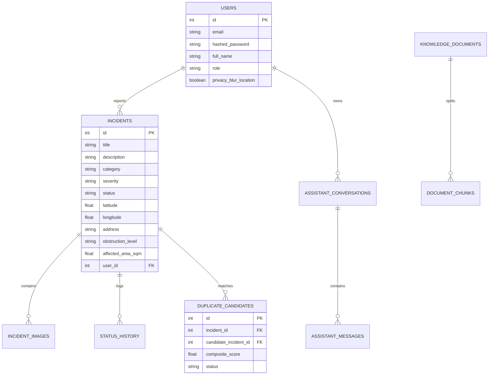

# CivicMind AI: System Architecture & Design Specification

CivicMind AI is an evidence-aware full-stack platform for civic defect triage, multi-signal duplicate detection, statutory grievance guidance, and municipal operations.

---

## 1. System Architecture Diagram

---

## 2. Multi-Signal Duplicate Detection Architecture

The duplicate detection score $S \in [0, 1]$ is computed as:

$$S = w_{geo} \cdot S_{geo} + w_{text} \cdot S_{text} + w_{cat} \cdot S_{cat} + w_{time} \cdot S_{time} + w_{img} \cdot S_{img}$$

Where weights are empirically configured:
* $w_{geo} = 0.35$ (Haversine distance thresholded at $25\text{m}$, $75\text{m}$, $200\text{m}$)
* $w_{text} = 0.25$ (Jaccard token similarity + character $3$-gram cosine overlap)
* $w_{cat} = 0.20$ (Exact category match $= 1.0$, compatible categories $= 0.6$)
* $w_{time} = 0.10$ (Exponential decay over hours elapsed)
* $w_{img} = 0.10$ (Cosine similarity of normalized 128-dimensional latent visual embeddings)

---

## 3. Database Entity-Relationship Diagram

